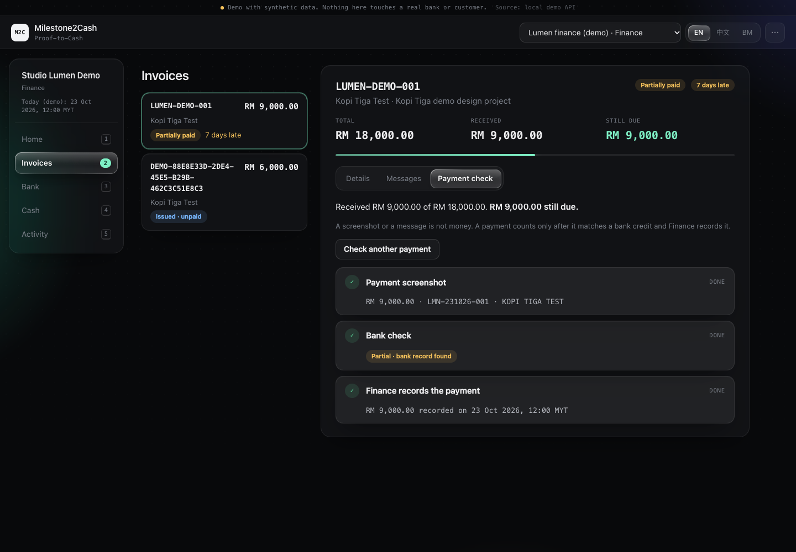
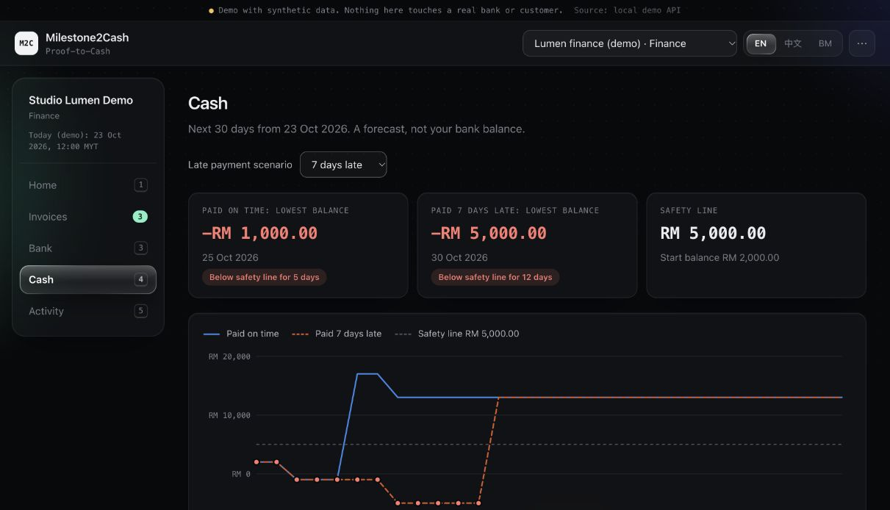

# STEP-7 local integration

The supplied React frontend is integrated with all 17 backend operations. Local technical checks pass. The project owner subsequently requested skipping the ten-screenshot human timing comparison and independent team review on 24 October 2026. These checks were not performed; Issue #23 closes with this explicit scope change. This report does not claim deployment, submission readiness or measured staff time savings.

## What changed

- The application defaults to the local API; `?source=mock` explicitly selects fixtures. The active source is visible in the demo banner.
- Receipt originals load through authenticated requests and their object URLs are released when the identity or receipt changes.
- Successful mutations refresh the workspace and forecast. Identity changes discard old forms and late responses, including late mutation results.
- Lost responses retain the same idempotency key on retry. A confirmed write followed by a failed refresh clears stale balances and offers a read retry; it does not ask the user to submit the write again.
- Matching displays the latest server result and checks invoice, receipt, ledger and credit versions before approval. Partial receipts retain the remaining collection amount; full settlement stops collection.
- Promise confirmation uses reviewed fields. Fulfilled or superseded promises are not presented as future receipts. The cash selector includes the default zero-day delay and uses the server's MYT demo date.

## Reproducible checks

Use Node 24 LTS with dependencies installed in the root, `web/` and `contracts/` directories:

```sh
npm ci
npm ci --prefix web
npm ci --prefix contracts
npm run check
npm test
npm run test:web
npm run test:e2e
npm run build
npm --prefix contracts run check
```

The browser suite uses installed Google Chrome on macOS when available. Otherwise install its Chromium runtime with `npx playwright install chromium`. It creates its own temporary SQLite database and Vite/API listeners and does not reuse the local demo database or API credentials.

| Check | Recorded result |
| --- | --- |
| Backend TypeScript and HTTP/integration tests | Pass; 46 tests |
| Frontend TypeScript, unit and translation tests | Pass; 16 tests |
| Real HTTP browser integration | Pass; 3 multi-step scenarios |
| Production frontend build | Pass |
| Frozen contract/data checks | Pass; 13 groups |
| Real OCR/DeepSeek and deterministic evaluations | See [metrics and retained errors](STEP7-METRICS.md) |

The application checks ran with Node 24.19.0. The separately recorded real-model evaluation used Node 25.8.1; its report retains that actual runtime. Tests are kept outside production modules: backend scenarios in `tests/integration/`, browser scenarios in `tests/integration/browser/`, frontend unit tests in `web/tests/`.

## Browser scenarios

1. **Invoice and payment journey:** switch to the project manager, complete a milestone and create its invoice draft; approve as Owner; switch to Finance; generate and explicitly confirm a simulated reminder. Upload a synthetic receipt, recover from an intentionally unavailable OCR/model provider by reviewing fields, display its authenticated original, match a bank credit and approve RM9,000 against an RM18,000 invoice. Verify the RM9,000 remainder stays collectible. Review a reply and confirm a promise for the remainder, verify its date and a seven-day delay in the forecast, then import and approve the final receipt. Verify full settlement, stopped collection and removal of duplicate expected income.
2. **Unknown write outcome and company isolation:** commit a reminder but drop its response. The UI shows uncertainty rather than success. Retry with the same idempotency key and verify exactly one reminder. Switch company on a mobile viewport and verify the new company and its own forecast.
3. **Confirmed write, failed refresh:** let a write succeed but fail the subsequent workspace request. Verify stale balances and write controls disappear, an explicit saved-but-refresh-failed message appears, and a read-only retry restores exactly one saved result.

Browser tests intentionally disable external OCR/model providers to make manual recovery deterministic. They still use the real application, HTTP handlers and SQLite transactions. They are not counted as successful real AI calls. The existing backend suite separately covers wrong roles, rejection, stale evidence, duplicate imports/allocations, rollback and restart persistence.



[Mobile view of the second company's forecast](images/step7-mobile-cash.png) was checked after clearing the previous company's state. Runtime JSON and failure traces are kept locally under `.local/browser-results/`.

## Live-provider UI smoke

An additional local browser session used the existing private DeepSeek key with `DEEPSEEK_MODEL=deepseek-flash`. It generated an AI-labelled reminder, explicitly confirmed simulated sending, and extracted the synthetic reply “I will pay RM18,000 on 28 October 2026.” as a promise with 95% confidence. Finance confirmation added an expected receipt on 28 October; selecting seven days late moved it to 4 November. No payment was created by the promise. Keyboard navigation from Cash to Home was also checked.

An initial run with only the key and no model setting correctly used the labelled template fallback. After restoring the complete model configuration, the UI showed the real AI draft. This initial fallback is not counted as a successful model call. Keys remain in ignored, server-side `.env` files and are not embedded in frontend assets or evidence.



## Human evidence excluded by request

- Use the same ten synthetic screenshots for the manual and tool workflow, with the same start/end points. Include review and correction time in both results and record actual elapsed times; model latency alone cannot establish a human speedup.
- Another team member must follow the recorded workflow and provide their own conclusion. Automated test results are not a member's signoff.

The deployment link, competition video and final submission checks remain in STEP-8.
