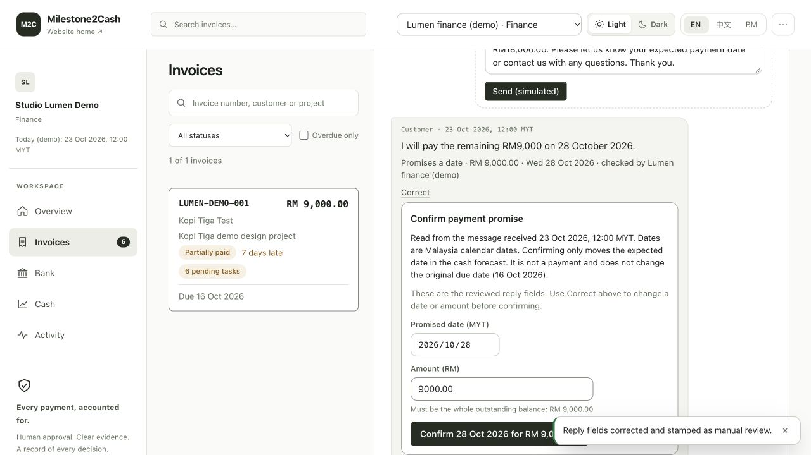

# STEP-8 final deployment and submission check

Checked on **25 October 2026, Malaysia time**. Application baseline: [`c4386784c9b5dacf44cc97e57a0c731931da36da`](https://github.com/jake2ace/SDC-Tracker/commit/c4386784c9b5dacf44cc97e57a0c731931da36da). This delivery adds materials and verification records without changing application code.

## Evidence against Issue 24

1. **Deployment configuration and access checked.** The public website and `/health` returned HTTP 200. Health reported the demo service and ready database. The deployed React frontend and Node API share one origin. Environment variables and the actual storage boundary are documented in [deployment instructions](../DEPLOYMENT.md) and the [hosted verification record](HOSTED-VERIFICATION.md).
2. **Core workflows and independent production checks passed; hosted storage remains limited.** The [six live browser workflows](../../submission/validation/results.json) passed on 25 October. A separate clean install of the same baseline passed 60 backend tests, 23 frontend tests, 13 contract/data groups, backend/frontend type checks and the production build. Four deployment tests are included in the 60 backend tests. Nine additional real production-process checks covered no-key fallback, manual correction, matching, approval, permissions, stale evidence, idempotency, restart and explicit startup failures. See the [independent report](STEP8-INDEPENDENT-PRODUCTION.md). These checks prove local production-process restart persistence. A prior Replit pause/resume failed; republishing restored service but reset the hosted ledger and uploads. Hosted restart/redeployment durability has not passed and is not inferred from local tests.
3. **Required material set present.** The [submission index](../../submission/README.md) links the official-template PRD, pitch deck, working prototype, Technical Declaration, public GitHub repository and 6:19 YouTube video, plus Replit evidence and a RunPod non-use statement. The final forms retain the leader-authorised typed signature Jiazhong Yang and date 25 October 2026.
4. **Claims and simulation boundaries checked.** All business data and bank records are synthetic. Invoice issuance, messaging and payment recording are simulated application actions. CSV import and bank matching do not post money; Finance approval is required. There is no live Orbyte, bank, payment, WhatsApp or MyInvois integration. No model training, fine-tuning, independent SME validation or measured staff-time savings is claimed. UI confidence values are not evaluation accuracy.
5. **Team facts, material versions and links checked.** The four registered members and actual contributions were confirmed by the team, as were mandatory workshops and prior-work/IP answers. Model names GPT-6 Astra and Fable 5.1 were supplied by the team. The deck labels its earlier 69-check baseline and links the current demo, repository and video. Video duration shown by the browser is 6:19; an unauthenticated YouTube oEmbed request returned HTTP 200 with the expected title and author. The repository is public. Official FAQ and portal show the deadline as 25 October 2026, 07:59 AM MYT. Handbook and Domain 2 source file versions were unchanged from the inspected rules.
6. **Saved competition submission state verified.** Refreshing the authenticated portal displayed the team's GitHub URL under “Your submission”, “API integration confirmed”, and the edit deadline. The [status record and screenshot](../../submission/SUBMISSION_STATUS.md) preserve the existing saved state. The original save timestamp is not shown. This material-upload workflow did not reaccept or change the stored API integration declaration.

## Current live demonstration

The retained shared invoice `LUMEN-DEMO-001` shows **RM18,000 received, RM0 due, two RM9,000 payments**, and reminders stopped. A separate final-handover invoice remains unpaid for RM6,000. The live state was inspected again during this check without resetting or redeploying it. The landing-page walkthrough is labelled an illustration and can still show the opening synthetic example.

To replay from RM0 received, follow the clean local setup and [synthetic demo sequence](../../data/demo/README.md). The hosted instance currently provides a settled-result inspection. Do not silently reset the shared instance or present it as untouched seed data.

## Browser-visible no-key behavior

An isolated production instance had `DEEPSEEK_API_KEY` explicitly empty. The browser generated a **Template · English** reminder using the current RM9,000 balance and displayed “Nothing was sent.” Adding a new RM9,000 promise reply displayed **MODEL_NOT_CONFIGURED** and directed the reviewer to manual entry. Saving manually entered intent, amount, date and correction reason stamped the Finance reviewer and left the balance unchanged at RM9,000 paid / RM9,000 due. The promise was not confirmed and no new payment was created.

This screenshot is from the isolated local production check. It is not a screenshot of key removal on Replit. The separate production-process checks prove that manually corrected receipt evidence can still be matched by rules and approved.

## Version and measurement boundaries

The deck and recorded pitch retain the historical 69-check baseline: 50 API, 16 UI and three automated browser scenarios. Slide 11 now labels the older baseline and records the later 60-backend / 23-frontend / 13-contract-group scope. The older three automated browser scenarios were not rerun. The six live F01-F06 cases and nine independent production-process checks are separate records; they are not added into a single accuracy percentage.

Historical 40-receipt / 40-reply evaluation results predate the reply-semantic guard changes. Final workflow checks do not rerun that benchmark. No current-model benchmark or real-business return on investment is implied.

## Accepted demonstration scope and completion

The final materials were merged into `main` in [PR 39](https://github.com/jake2ace/SDC-Tracker/pull/39), merge commit `ab43055bf8d909c7295d4fecd9a31cbfbcc3cd55`. Files read back from `main` matched the reviewed PDF, deck, notes and manifest Git blobs.

On 25 October 2026 the team leader explicitly selected: “这次先用现有演示，后续再完善数据保存” — use the existing tested demonstration for this competition and improve data persistence later. STEP-8 is completed against this confirmed demonstration scope. The current hosted app and settled synthetic ledger are retained; this completion does not claim that hosted restart or redeployment durability passed. That engineering work is tracked separately in [follow-up issue 40](https://github.com/jake2ace/SDC-Tracker/issues/40).

The portal's stored API integration checkbox remains recorded as a website state, not as independent sponsor-policy verification. The current hosting belongs to the teammate's Replit account; no deployment on the leader's own computer is required.
