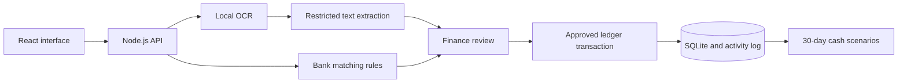

# Milestone2Cash Proof-to-Cash

Working submission text · 24 October 2026. Sections below map to the [official Preliminary Submission template](https://docs.google.com/document/d/1RUb7bQvtaI5ds8SLHQtzAFmg8OGb9WsK/edit). This file is not a submitted or signed form. Section 2.1 is below 250 words, 2.2 below 300 words and 3.2 below 200 words; count again after final edits.

## 1. Team and project

| Field | Current value |
| --- | --- |
| Team | Lets go |
| Challenge | Domain 2 — Orbyte Smart SME Challenge |
| Proposed SDG alignment | SDG 8; targets 8.2 and 8.3, subject to team confirmation |
| Team leader | Jiazhong Yang — Monash University Malaysia |
| Registered members | LOW LI XIN — Universiti Malaya; Jieheng Li — Monash University Malaysia; Lingchen Wu — Monash University Malaysia |
| Deployment, video and final submission links | Add only after each link has been verified |

## Product summary

Milestone2Cash Proof-to-Cash helps Malaysian service micro-businesses follow a payment from completed work to a reviewed ledger entry. It connects milestone invoicing, reminder drafts, customer replies, payment screenshots, imported bank records and a 30-day cash forecast. OCR and AI help read evidence; explicit rules check the bank match; a Finance user approves the payment. A partial receipt reduces the outstanding balance while collection of the remainder continues. A confirmed promise changes expected receipt timing without becoming actual cash. The working prototype uses synthetic business and bank data, with simulated sending and no movement of real money.

## 2.1. Problem statement

The intended users are owners and finance staff in small project-based service businesses, such as design, renovation, event and IT teams. A single invoice can involve a completed milestone, a reminder, a WhatsApp reply, a transfer screenshot and a bank record. These records answer different questions: a customer's payment claim is evidence to review, while a matching bank credit supports recording a receipt.

Our design scenario is an overdue RM18,000 invoice with a RM9,000 transfer. Marking the invoice as fully paid would hide the remaining RM9,000. Treating a promise for that remainder as cash would overstate available funds. The prototype makes the remaining balance and the basis of each decision visible in one workflow. This scenario is synthetic; customer interviews and measured business savings are not claimed.

## 2.2. Proposed AI solution

1. A project manager completes a milestone and creates an invoice draft. The Owner approves and issues it in the demo ledger.
2. Finance reviews an editable reminder and explicitly confirms simulated sending.
3. Finance pastes a customer reply or uploads a payment screenshot. Local OCR reads the image; DeepSeek helps structure permitted text and interpret the reply. Uncertain or invalid results require review.
4. Rules compare reviewed evidence with imported synthetic bank credits. The result explains a full match, partial match, mismatch, missing bank entry, duplicate or need for review.
5. Finance approves an eligible match. One transaction records the payment, allocates the credit, updates the balance and writes the activity record. Repeated submissions cannot allocate the same credit twice.
6. A partial payment leaves the remainder collectible; full settlement stops collection. A separately confirmed promise changes the expected date of the remainder. The 30-day on-time and delayed scenarios keep actual receipts separate from expected receipts.

The key product decision is to connect evidence review with the outstanding balance and cash forecast, rather than treating screenshot extraction as the final result. The prototype includes two synthetic companies to demonstrate reuse and company-level data separation.

## 3.1. Technical implementation

The React and TypeScript interface calls seventeen Node.js API operations backed by SQLite. Tesseract.js performs OCR locally. DeepSeek `deepseek-flash` supports reminder drafting, reply interpretation and extraction from permitted OCR text. Model inputs are restricted and redacted; original screenshot images are not sent to the model. The API key stays on the server.

Amounts use integer MYR sen. Permissions and company boundaries are checked by the server. Approval rechecks the invoice, screenshot and bank-record versions; changed evidence requires a fresh match. Database transactions, idempotency keys and unique credit allocation protect retries and concurrent approvals. Manual correction and template reminders remain available when the model cannot be used. Demo identity switching is not production authentication.

**Sponsor API and cloud status:** no live Orbyte integration and no RunPod use are claimed. Replit use and deployment must be recorded from actual platform evidence before completing the template's corresponding questions.

## 3.2. Design approach and deployment

The design starts from a synthetic service-business payment journey: completed work, approved invoice, reminder, customer evidence, bank check and reviewed payment. Each screen exposes the relevant source record and next human decision. The main scenario retains the unpaid half of an RM18,000 invoice after a RM9,000 receipt; a confirmed promise then changes only the remaining expected receipt date.

Implementation follows a shared API contract, with separate frontend and backend work and integration tests outside production modules. The local interface and API are connected, and synthetic workflow tests cover recovery, partial settlement and company switching. The recorded OCR/model evaluation includes its errors rather than repairing results against labels.

Customer interviews, the paired manual timing study and independent team review have not been performed. Public deployment and platform proof of use require separate verified evidence; local completion is not a deployment claim. The next validation is a permissioned business pilot with a measured workflow baseline.

## 4. SDG alignment and proposed impact measures

Proposed primary alignment is **SDG target 8.2**, which relates productivity to technological upgrading and innovation. **Target 8.3** is a secondary proposed link through its emphasis on entrepreneurship and micro-, small- and medium-sized enterprise development. The tool's intended contribution is more reliable, traceable record handling in small firms; it does not measure the UN indicators for GDP per worker or informal employment. [United Nations, Goal 8 targets](https://sdgs.un.org/goals/goal8).

| Proposed measure | Measured Phase 1 baseline | Proposed Phase 2 target, subject to team confirmation |
| --- | --- | --- |
| Exact receipt-reference extraction | 35/40, or 87.5%, on the frozen synthetic set | At least 95% on a separately held-out synthetic set with the same four-layout coverage; a 7.5 percentage-point increase over the recorded baseline |
| Unsafe bank-match approval candidates | 0/30 frozen cases | Retain zero in an expanded, independently labelled exception set |
| Staff time and business impact | Not measured; no baseline assumed | Establish a consented workflow baseline before proposing a percentage reduction |

The accuracy measure is an engineering proxy for less correction work, not evidence of economic impact. The Phase 2 percentages are proposed targets, not achieved results or team commitments. Source for measured baselines: [STEP-7 metrics](../docs/evaluation/STEP7-METRICS.md). The held-out evaluation must retain rejected outputs in the denominator and avoid training or tuning against its labels.

### Supporting technical results

The recorded evaluation used frozen synthetic data. The real OCR/DeepSeek run on 24 October 2026 included 40 receipt images across four layouts and 40 English, Chinese and Malay replies. One instruction-bearing reply was blocked before a model request and remains a miss in the accuracy denominator.

| Measure | Recorded result |
| --- | --- |
| Receipt amount exact | 40/40 — 100% |
| Receipt reference exact | 35/40 — 87.5% |
| Receipt transfer time exact | 40/40 — 100% |
| Reply intent exact | 39/40 — 97.5% |
| Low-confidence replies sent to review | 11/11 |
| Deterministic matching cases | 30/30; zero unsafe approval candidates in this set |
| Independent forecast comparisons | 40/40 daily results across four cases |
| Current regression checks | 50 backend tests, 16 frontend tests and three browser scenarios passed |

The five reference misses were retained `O`/`0` OCR confusions. Correct extraction does not automatically make a record ready for approval: six receipts required date review against the frozen demo clock. The browser scenarios separately cover partial and full settlement, manual recovery, retries and company switching. See [the metrics report](../docs/evaluation/STEP7-METRICS.md), [integration report](../docs/evaluation/STEP7-INTEGRATION.md) and [deployment checks](../docs/DEPLOYMENT.md) for methods, errors and the four additional backend checks in the current total.

## 5. Readiness and validation boundaries

The intended benefit is less repeated record handling and clearer visibility of what has actually been received, what is still owed and why. This is the proposed link to SDG 8; improvements in productivity, income or business resilience have not been measured.

The ten-screenshot manual timing comparison and independent team review were not performed and were skipped by the project owner on 24 October 2026. No time-saving percentage, user endorsement or independent review conclusion is claimed. Synthetic test accuracy does not establish real-bank accuracy or production readiness.

The prototype has no live bank, WhatsApp, MyInvois or Orbyte connection. It neither transfers money nor verifies screenshot authenticity at the pixel level. The next validation would use permissioned business samples and a paired workflow study, followed by production authentication, operational controls and any required integration work. Public deployment, platform evidence and actual competition submission must each be verified separately.

**Fields requiring actual team input:** workshop participation, readiness declarations, assigned presenters and confirmation of the proposed SDG targets. Do not infer participation from the existence of this prototype.

## 6. Originality, prior work and third-party material

The current project follows the selected `LetsGo_Final_Idea.pdf` concept. An earlier Milestone2Cash prototype existed and was archived before the current implementation was rebuilt. The team must confirm the exact prior-work description, ownership and any IP conflicts in the official declaration. This document does not certify them.

The implementation uses third-party software and AI services. The final technology declaration must list the actual libraries, models, datasets, development assistance and applicable licenses, including React, Node.js, SQLite, Tesseract.js and DeepSeek where used. The synthetic evaluation data and its generation method are documented in the repository. Review the actual dependency inventory and source records before signing; do not treat this short list as the complete declaration.

## 7. Captain's declaration

Captain: **Jiazhong Yang**. Signature and signing date: **pending completion by the captain**. No signature or agreement is represented by this draft.
