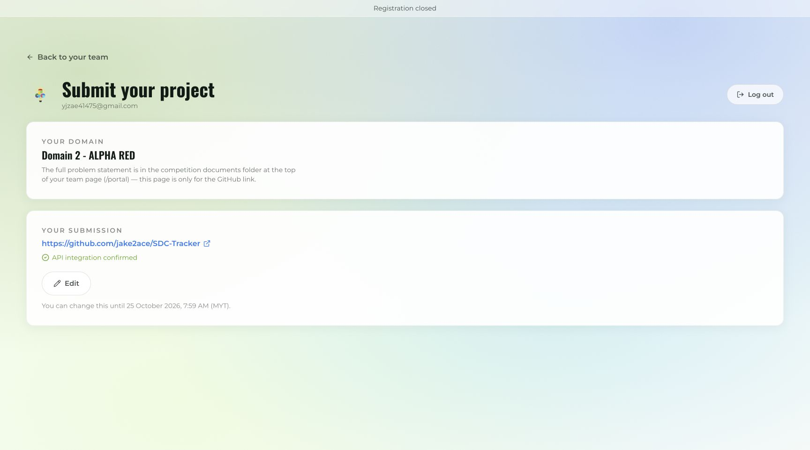

# Saved competition submission status

On 25 October 2026, the authenticated team submission page was refreshed and displayed:

- Domain: Domain 2 - ALPHA RED.
- Your submission: https://github.com/jake2ace/SDC-Tracker.
- Stored form status: API integration confirmed.
- Edit deadline: 25 October 2026, 7:59 AM MYT.

This screenshot records the portal's existing saved state. The final-material upload workflow did not change or reaccept the API integration statement. The portal does not expose the original save time, so the screenshot capture time must not be described as the original submission time. The stored checkbox is not independent evidence about sponsor eligibility.

The repository contains the final PDFs, deck and video link referenced by this submission. The application baseline is c4386784c9b5dacf44cc97e57a0c731931da36da; the material upload is a later documentation commit. The final pull request and commit are recorded in the GitHub history.
